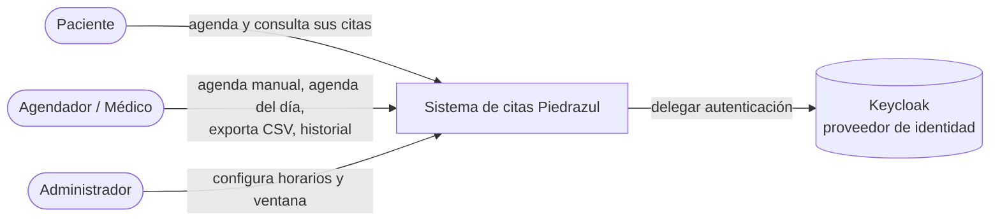
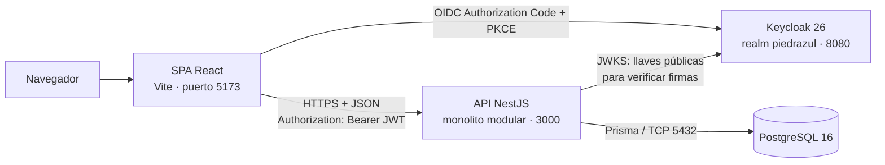
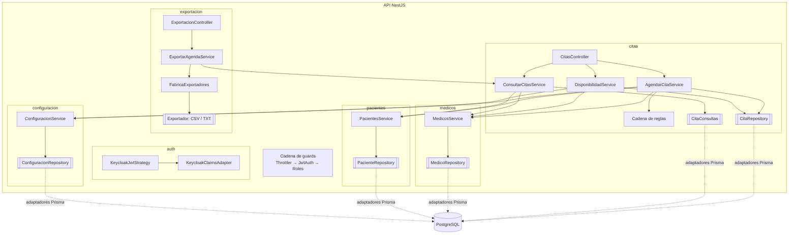
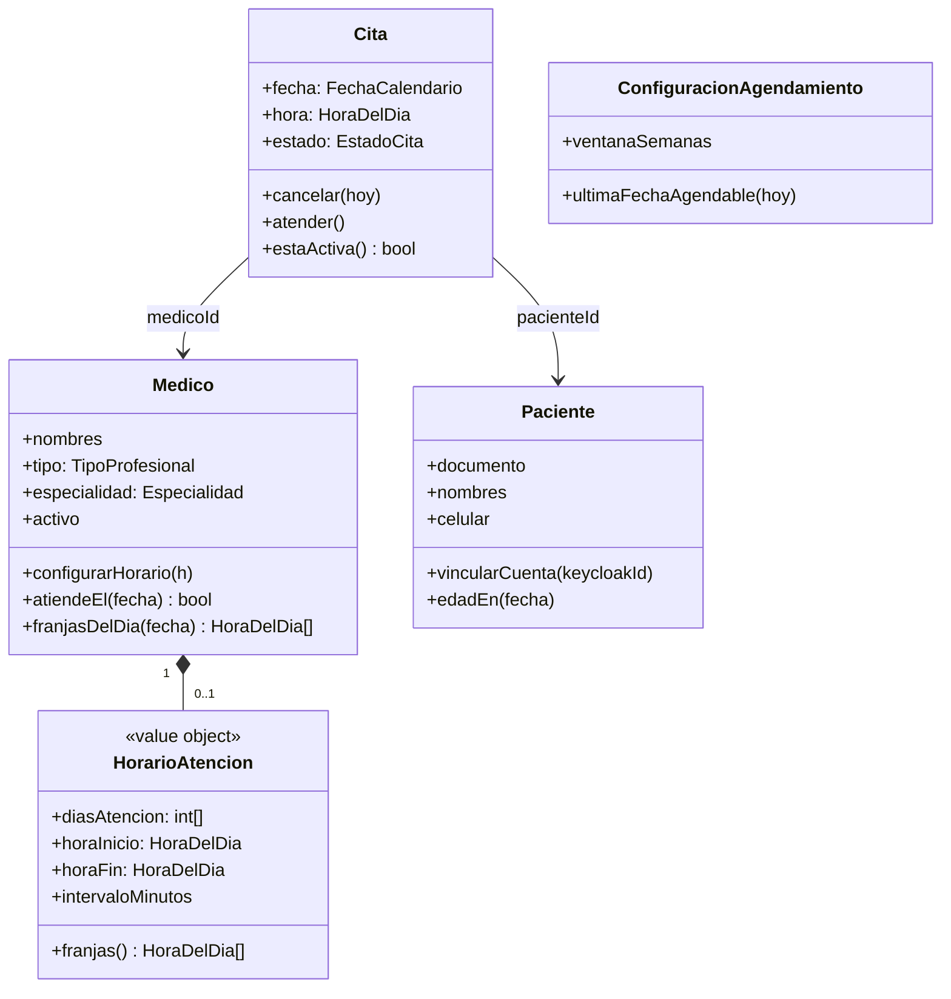
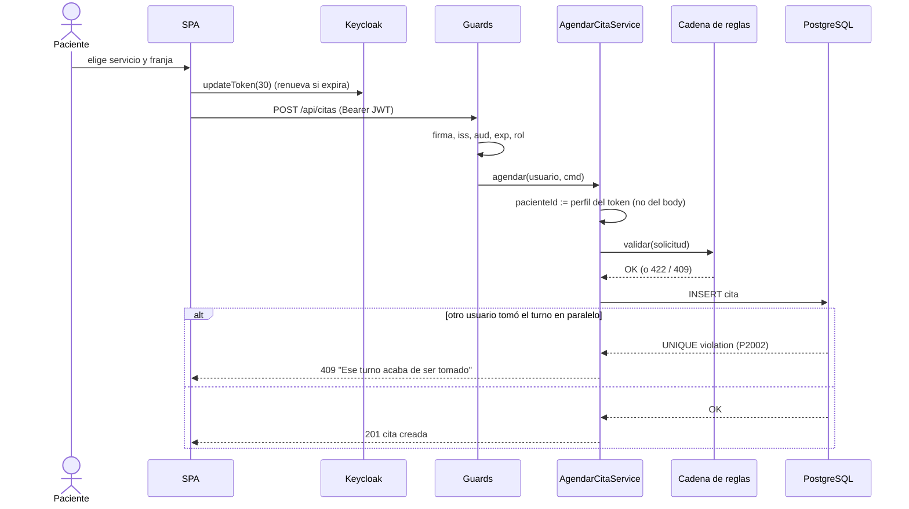
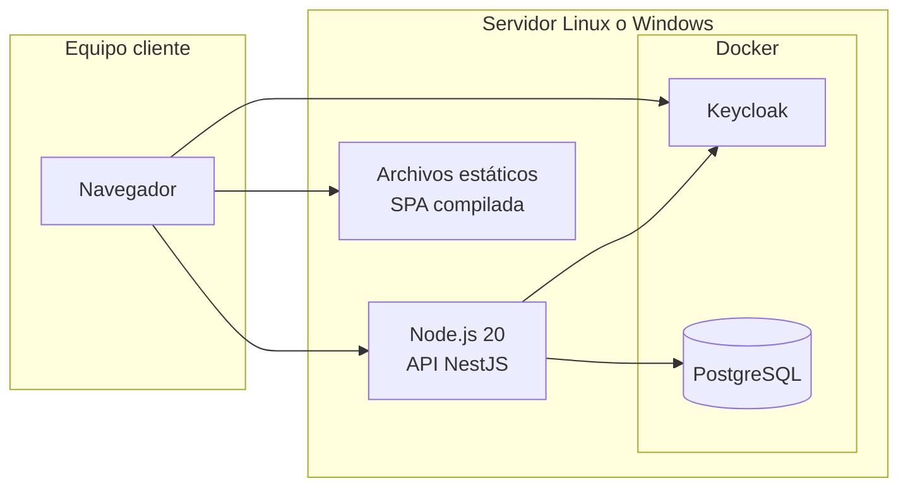

# Documento de arquitectura · Piedrazul (segundo corte)

> Base para el documento PDF del corte. Los diagramas usan Mermaid (GitHub los dibuja solos;
> para el PDF puede exportarlos desde https://mermaid.live).

---

## 1. Decisiones de arquitectura (ADR)

### ADR-01 · Tipo de aplicación: SPA
**Contexto.** El personal trabaja todo el día sobre la misma pantalla de agenda y el paciente sigue un asistente de varios pasos.
**Decisión.** Single-Page Application en React.
**Razones.** Navegación sin recargas (flujo continuo en el asistente de agendamiento), separación limpia frontend/API (la misma API sirve a una app móvil futura) y buen soporte del flujo OIDC + PKCE de Keycloak.
**Consecuencias.** El primer cargue es más pesado que una MPA (≈73 KB gzip, aceptable); el SEO no importa en un sistema interno.

### ADR-02 · Estilo: monolito modular con arquitectura hexagonal por módulo
**Contexto.** El enunciado pide refactorizar a un monolito modular, con evolución futura (multi-tenencia, escalabilidad).
**Decisión.** Un único desplegable NestJS dividido en módulos por capacidad de negocio: `pacientes`, `medicos`, `configuracion`, `citas`, `exportacion`, `auth` y `shared`. Cada módulo tiene tres capas:

| Capa | Contiene | Depende de |
|---|---|---|
| `domain` | Entidades, Value Objects, reglas, **puertos** (interfaces) | nada externo |
| `application` | Casos de uso que orquestan el dominio | `domain` |
| `infrastructure` | Controladores HTTP, DTO, **adaptadores** Prisma | `application`, `domain`, frameworks |

**Regla de dependencia.** Las flechas apuntan hacia el dominio. El dominio no importa NestJS, Prisma ni Express (esto se verifica: las 125 pruebas unitarias corren sin base de datos).
**Comunicación entre módulos.** Solo por los servicios que cada módulo **exporta**. `citas` nunca lee la tabla `Medico`: le pide a `MedicosService`. Así un módulo podría extraerse a microservicio sin reescribir los demás.
**Por qué no microservicios.** Para el tamaño del equipo y del problema agregan complejidad operativa (red, consistencia distribuida, despliegue) sin beneficio hoy. El monolito modular deja la puerta abierta.

### ADR-03 · Tecnologías
| Necesidad | Elección | Alternativa descartada y por qué |
|---|---|---|
| Backend modular con DI | **NestJS** | Express puro: no trae módulos ni inyección de dependencias |
| Frontend SPA | **React + Vite** | Se conserva del corte 1; Vite da arranque y build rápidos |
| Base de datos | **PostgreSQL** | SQLite (corte 1): bloquea toda la BD al escribir, no sirve para concurrencia real ni índices únicos parciales |
| ORM | **Prisma** | TypeORM: Prisma da tipos generados y migraciones más simples; queda aislado en adaptadores |
| Identidad | **Keycloak** | JWT propio: obligaba a guardar secretos y contraseñas; Keycloak trae registro, bloqueo por fuerza bruta, políticas de contraseña y expiración de sesión |

### ADR-04 · La concurrencia se garantiza en la base de datos
**Problema.** Dos usuarios pueden pedir el mismo turno al mismo tiempo. Validar en código ("¿está libre?" → "guardar") tiene una condición de carrera: ambos leen "libre".
**Decisión.** Restricción `UNIQUE (medicoId, fecha, hora, activa)`. La columna `activa` vale `true` en citas vigentes y `NULL` en canceladas; como PostgreSQL considera distintos los `NULL`, una cita cancelada libera el turno sin borrar el historial. El repositorio traduce la violación (`P2002`) a `ConflictoError` → HTTP 409.

---

## 2. Modelo C4

### Nivel 1 · Contexto


### Nivel 2 · Contenedores


### Nivel 3 · Componentes de la API

`[[ ]]` = puerto (interfaz). La línea punteada es la implementación en infraestructura.

---

## 3. Vistas 4+1

### Vista lógica · modelo de dominio


### Vista de procesos · agendar una cita (RF2)


### Vista de desarrollo · organización del código
```
backend/clinica-api/src/
├── shared/          núcleo compartido: errores, FechaCalendario, HoraDelDia, Reloj, Prisma
├── auth/            Keycloak: estrategia JWT, adaptador de claims, guards, decoradores
├── pacientes/       domain · application · infrastructure
├── medicos/         domain · application · infrastructure
├── configuracion/   domain · application · infrastructure
├── citas/           domain (+ reglas/) · application · infrastructure
├── exportacion/     domain (estrategias) · application · infrastructure
└── testing/         dobles de prueba (repositorios en memoria, reloj fijo)

frontend/src/
├── core/            auth (Keycloak), http (ApiClient + fachada api.ts), tipos
├── shared/          componentes reutilizables, hooks, utilidades de fechas
├── features/        una carpeta por funcionalidad (agenda, agendar, historial…)
└── app/             rutas y layout
```

### Vista física · despliegue

Portabilidad (RNF 6): todo corre sobre Node.js y contenedores, sin cambios entre Linux y Windows.

### Escenarios (+1)
Los casos de uso del corte (RF1–RF5) guían las cuatro vistas; el diagrama de procesos anterior recorre el escenario más crítico (RF2 con concurrencia).

---

## 4. Patrones de diseño GoF implementados

| Patrón | Tipo | Dónde | Problema que resuelve en Piedrazul |
|---|---|---|---|
| **Chain of Responsibility** | Comportamiento | `citas/domain/reglas/` | Siete reglas de agendamiento (médico activo, fecha no pasada, ventana, día de atención, franja válida, turno libre, una cita por día). Cada una es un eslabón; agregar "no agendar en festivos" es una clase nueva. También la cadena de *guards* de NestJS (`Throttler → JwtAuth → Roles`). |
| **Template Method** | Comportamiento | `ReglaAgendamiento.validar()` y `exportacion/domain/exportador-tabular.ts` | El algoritmo de exportar (prefijo → encabezado → filas → pie) es fijo; CSV y TXT solo implementan los pasos que cambian. |
| **Strategy** | Comportamiento | `exportacion/domain/exportador.ts`, `csv.exportador.ts`, `texto-plano.exportador.ts` | RF4 pide CSV, el sistema actual imprime texto. Mañana PDF o Excel: nueva estrategia, sin tocar servicio ni controlador. |
| **Factory** | Creacional | `exportacion/domain/fabrica-exportadores.ts` | Elige la estrategia según `?formato=` sin `switch`. Las estrategias se registran por inyección (OCP). |
| **Adapter** | Estructural | `auth/infrastructure/keycloak-claims.adapter.ts` y los repositorios `Prisma*Repository` | Convierte el token de Keycloak en `UsuarioAutenticado` y las filas de Prisma en entidades. Cambiar de proveedor de identidad o de ORM afecta solo al adaptador. |
| **Singleton** | Creacional | `frontend/src/core/http/api-client.ts` (y los providers de Nest, singleton por defecto) | Un único cliente HTTP con la URL base, el token y el manejo de errores; antes cada servicio repetía `fetch` con URLs fijas. |
| **Facade** | Estructural | `frontend/src/core/http/api.ts` | Los componentes llaman `citasApi.agendaDelDia()` sin conocer rutas ni verbos HTTP. |

**Patrones de arquitectura complementarios:** Repository (puertos de persistencia), Ports & Adapters (hexagonal), DTO (entrada/salida HTTP), CQRS ligero (`CitaRepository` para escribir y `CitaConsultas` para leer), Value Object (`FechaCalendario`, `HoraDelDia`, `HorarioAtencion`) y Domain Service (`CalculadoraDisponibilidad`).

## 5. Principios SOLID aplicados

| Principio | Evidencia |
|---|---|
| **S** – Responsabilidad única | Controladores delgados (reciben y delegan); el cálculo de franjas salió de `CitasService` a `HorarioAtencion` y `CalculadoraDisponibilidad`; una clase por regla. |
| **O** – Abierto/cerrado | Nuevas reglas, formatos de exportación o tipos de error se agregan sin modificar código existente (cadena, fábrica, mapa del `DomainExceptionFilter`). |
| **L** – Sustitución de Liskov | Los repositorios en memoria sustituyen a los de Prisma en las pruebas sin que los servicios lo noten; cualquier `ExportadorTabular` sirve donde se pide un `Exportador`. |
| **I** – Segregación de interfaces | `CitaRepository` (escritura) separado de `CitaConsultas` (lectura); cada puerto expone solo lo que su consumidor usa. |
| **D** – Inversión de dependencias | Los servicios dependen de puertos (`PACIENTE_REPOSITORY`, `RELOJ`…) y Nest inyecta el adaptador. El dominio no conoce Prisma ni la hora del sistema. |

---

## 6. Escenarios de calidad · Seguridad

| | Escenario S1 · Autenticación | Escenario S2 · Autorización por rol | Escenario S3 · Control de acceso a objetos |
|---|---|---|---|
| **Fuente** | Atacante externo | Usuario autenticado con rol `paciente` | Paciente autenticado |
| **Estímulo** | Llama `GET /api/citas` sin token, con token vencido o firmado por otra llave | Intenta `PUT /api/configuracion` o `GET /api/citas/historial` | Envía `PATCH /api/citas/{id}/cancelar` con el id de la cita de otra persona, o `POST /api/citas` con `pacienteId` ajeno |
| **Artefacto** | API (cadena de guards) | API (`RolesGuard`) | `AgendarCitaService` |
| **Entorno** | Operación normal | Operación normal | Operación normal |
| **Respuesta** | Rechaza antes de llegar al controlador; no revela información | Rechaza la operación | Rechaza la cancelación; en la creación ignora el `pacienteId` y usa el del token |
| **Medida** | 100 % de peticiones sin JWT válido reciben **401** en < 50 ms | 100 % reciben **403**; ninguna modificación persiste | 100 % reciben **403**; verificado por prueba unitaria *"OWASP A01"* |
| **Resultado esperado** | Ningún dato de pacientes accesible sin autenticación | El paciente solo ve su menú y sus endpoints | Ningún paciente puede leer ni modificar citas ajenas |

Escenarios adicionales que cubre Keycloak por configuración (`infra/keycloak/piedrazul-realm.json`):
- **Fuerza bruta:** tras 5 intentos fallidos la cuenta se bloquea temporalmente (`bruteForceProtected`).
- **Sesiones inactivas (requisito no funcional 1 del proyecto):** la sesión expira tras 30 min sin actividad (`ssoSessionIdleTimeout = 1800`); el access token dura 5 min.
- **Contraseñas:** nunca pasan por la API; Keycloak las guarda con hash y exige mínimo 8 caracteres y un dígito.

---

## 7. Antes y después

| Aspecto | Corte 1 | Corte 2 |
|---|---|---|
| Autenticación | JWT firmado con secreto escrito en el código; **ningún endpoint lo verificaba** | Keycloak RS256; seguridad cerrada por defecto con guards globales |
| Validación de entrada | `@Body() body: any` (mass assignment) | DTO + `ValidationPipe` (`whitelist`, `forbidNonWhitelisted`) |
| Reglas de negocio | Dentro de servicios acoplados a Prisma | Entidades y cadena de reglas, sin dependencias externas |
| Concurrencia | Ninguna protección | Restricción única en BD + traducción a 409 |
| Borrar un médico | Borraba en cascada sus citas (pérdida de historial) | Se desactiva; el historial se conserva |
| Base de datos | SQLite versionado en Git | PostgreSQL en Docker; secretos en `.env` |
| Pruebas | Mocks de Prisma por método | 125 pruebas con repositorios en memoria; 97 % de cobertura en dominio y aplicación |
| Frontend | Exportación de Figma con ~40 dependencias, `fetch` repetido, sin rutas | 4 dependencias, router, cliente HTTP único con token |
